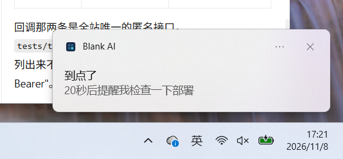

# v0.11.1 · 通知通道：让「到点了」真的响

> 上一版（v0.11.0）修通了「会自己醒」，但醒来之后没有任何东西告诉用户。
> 真机验收时模型甚至在结果里写了一句「提醒已弹出」——**那是它编的**，
> 当时整个仓库里一行 `Notification` 都没有（`grep` 零命中）。
> 这一版补的就是这一段。

## 1. 缺口到底在哪

v0.11.0 打通的是「任务会不会跑」：

- 说「40 秒后提醒我检查部署」→ 登记成 `intent=schedule`、写 `fire_at` → 到点自己起跑 ✅
- 说「盯着 README」→ 登记成 `intent=watch` → 文件一变就起跑 ✅
- 桌面形态没有独立 worker，`release_due_triggers` 自己起跑 ✅

跑完之后呢？结果落在 `agent_events` 里，只有**打开界面**才看得见。用户设了九点的提醒、
八点五十切去做别的事，九点零一分回来——界面上有结果，但没有任何东西把他叫回来。

真正的缺口不是「不会通知」，而是**通知的判定早就写好了，只是没人投递**：

| 已有 | 位置 | 状态 |
|---|---|---|
| 该不该打扰的判定 | `services/agent/notify.py`（`should_disturb` / `explain`） | 完整，四种策略 |
| 免打扰时段（含跨零点） | `services/settings.py::quiet_hours_active` | 完整 |
| 判定结果落库 | `notify.decided` 事件（带 `disturb` + `reason`） | 完整 |
| IM 投递 | `channels/delivery.py::fanout` | 企业微信/钉钉/飞书 |
| **桌面投递** | —— | **空的** |

所以这一版**不重写判定**，只补最后一条投递通道。

## 2. 分工：判定在后端，壳只负责弹

这条分界是刻意画的，写在这里是为了下次别有人「顺手」把判定搬到前端：

```
notify.py              回答：这一个事件该不该打扰？        ← 唯一判定源
   ↓ 写 notify.decided（disturb + reason + origin）
GET /api/v1/notifications   只吐 disturb=true 的那几条     ← 取数，不判断
   ↓ 壳轮询
notify-policy.cjs      回答：这条我弹过没有？他看着屏幕吗？这一分钟弹了几条？
   ↓
new Notification()     真的弹出来
```

为什么不让壳复判一遍「要不要打扰」：两套规则各判一次，迟早会漂。症状很难查——
「设置里明明写了免打扰、屏幕却在响」，用户没法知道该信哪一边。

壳这边只回答**只有壳才知道**的三个问题：

1. **这条我弹过没有** —— 游标是 `created_at`，SQLite 只到秒，同一批必然被读到两次；
2. **用户此刻是不是就看着这个窗口** —— 界面上任务卡自己会变，再弹一次是重复告知；
3. **这一分钟已经弹了几条** —— 一次跑完十几个子任务，屏幕上摞十几条 toast。

## 3. 改动

### 后端

- **`api/routes/notifications.py`（新）** — `GET /api/v1/notifications?since=&limit=`，
  扫 `agent_events` 里 `type=notify.decided` 且 `payload.disturb=true` 的行，join `tasks`
  补 `title / goal / thread_id / origin`。正序返回（老的在前——倒序会让最新那条被更早的盖住）。
- **`tasks.py::_record_notify_decision`** — `notify.decided` 多记一个 `origin`
  （`schedule` / `watch` / `user`）。没有它，定时提醒弹出来只能写「任务完成」。

### 桌面

- **`notify-policy.cjs`（新）** — 纯函数，禁止 `require("electron")`（和 `shell-policy.cjs`
  同一个理由：main.cjs 一旦 require 就跑不进普通 node 测试）。三个函数：
  `decideNotification` / `noticeText` / `rememberSeen`。
- **`main.cjs`** —
  - `app.setAppUserModelId("ai.blank.workbench")`，**在 ready 之前**；
  - `startNotificationLoop()`：启动先取一次，再按 `BLANK_NOTIFY_POLL_MS`（默认 15 秒）轮询；
  - `showNotification()`：`new Notification`，审批出声、其余静音；
  - `openThreadFromNotification()`：点 toast → 唤窗口 → `app://bundle/?thread=<id>`。
    已经在看同一条时不重载（重载会丢输入框里没发出去的字）。

### 前端

- **`settings/agent-runtime-panel.tsx`** — 新增「通知与免打扰」面板：通知策略下拉 +
  免打扰时段输入。`quiet_hours` 后端一直支持，但设置页从来没有入口，用户只能手改 `settings.json`。

## 4. 文案：同一句「任务完成」扣在提醒上就不像提醒

`noticeText` 按「谁起的 + 什么结果」分档：

| 条件 | 标题 | 例子正文 |
|---|---|---|
| `kind=approval` | 等你批准 | 要你批准的命令 |
| `kind=failure` | 没跑成 | 部署脚本那件事 |
| `origin=schedule` | 到点了 | 九点提醒我检查部署 |
| `origin=watch` | 有变化了 | 盯着工作区的 README.md |
| 其余 | 做完了 | 有一轮跑完了 |

审批优先于来源：定时任务卡在审批时，标题是「等你批准」而不是「到点了」——前者更急。

## 5. 三条降噪（每一条都对应一个具体的骚扰场景）

| 规则 | 为什么 | 写错了会怎样 |
|---|---|---|
| 按 `id` 去重 | 游标秒精度，同批必被读到两次 | 同一个提醒弹两遍 |
| 窗口聚焦且可见 → 不弹 | 用户就盯着界面，任务卡已经变了 | 打字时被自己的任务打断 |
| 一分钟 > 3 条 → 压着（审批除外） | 一次跑完十几个子任务 | 屏幕上摞十几条 toast |

**`settle` 与 `show` 是两件事**（`notify-policy.cjs` 里写了注释，这里再强调）：

- 「已弹过」「用户正看着」→ `settle=true`，记账。用户已经知道了，切走之后不必补弹。
- 「防刷屏压着」→ `settle=**false**`，**不记账**。这一轮只是「现在不说」，下一轮还得说。
  记成已处理等于永久丢掉它。

同理，`main.cjs` 里被压住的那一条**不能让游标往前走**，否则下一轮就读不到它了。

## 6. Windows 上最容易白干的一处：AUMID

`new Notification()` 在 Windows 上如果不设 AUMID，**不报错、不显示、日志里一个字都没有**。
壳里的值必须与安装器 `build.appId` 完全一致：

```js
// main.cjs（ready 之前）
app.setAppUserModelId("ai.blank.workbench");
```

```json
// desktop/package.json
"build": { "appId": "ai.blank.workbench" }
```

`main-wiring.test.cjs` 里有一条用例专门读 `package.json` 比对这两处——改一个漏一个就会红。

## 7. 读数

| 项 | 结果 |
|---|---|
| 后端 | `2290 passed / 23 skipped`（761 秒；含新增 18 例：`test_notifications_v111.py` 9 + `test_notify_policy_v111.py` 9） |
| 前端 | `296 passed`（`--test-concurrency=2`；默认并发会把进程拖到超时） |
| 前端类型 / lint | `tsc --noEmit` 0；`eslint` 0 |
| 桌面 | `108 passed`（原 74；新增 `notify-policy.test.cjs` 25 例 + 接线 8 例） |
| 打包自检 | `verify-package.cjs` rc=0，14 项；含「包内 `notify-policy.cjs` 与仓库逐字节一致」 |
| 版本一致性 | `check_versions.mjs` 六项一致，0.11.1；安装版 `ProductVersion=0.11.1.0` |

跑全量时撞到一条**和本版无关的老假红**，顺手修了：`test_channels_v103.py::test_wecom_crypto_roundtrip_and_corp_check`
原先断言「换一把 key 必然抛异常」，理由是「填充必然不合法」——不成立。`wecom._unpad` 和企微官方 SDK
一样只看尾字节是否在 1..32，不逐字节核对，所以错误 key 有 `32/256` 的概率解出「看起来合法」的尾字节，
再被当成随机长度切一刀、`receive_id` 落在切片外（空串 → 跳过企业号校验）就静默返回垃圾。实测 2 万次
**2478 次不抛（12.4%）**，即这条用例从 v0.10.3 起约有 1/8 概率假红。改成断言它真正要保的性质
（「拿不到原文」）后连跑 30 次全过。产品代码一个字没动。

## 8. 真机验收

环境：`dist/Blank-AI-安装版-0.11.1.exe` 装到 `D:\Softwares\kbg\blank-ai-workbench-desktop`，
后端随包起在 `127.0.0.1:8000`；主窗口收进托盘（不可见、无焦点），
`BLANK_NOTIFY_POLL_MS=3000` 把轮询调快（默认 15 秒）。

### 8.1 「到点了」真的出现在右下角



| 项 | 证据 |
|---|---|
| 弹窗本身 | 上面这张图（`docs/evidence/v0.11.1-toast-schedule.png`） |
| 应用名 / 标题 / 正文 | `Blank AI` / **到点了** / `20秒后提醒我检查一下部署` |
| 和日志对得上 | 帧文件时间 `17:21:57`；日志 `09:21:56.952Z`（= 本地 17:21:56）`弹通知：到点了｜20秒后提醒我检查一下部署（task=507531ae…）` |

怎么抓的：toast 只活几秒，所以**先起拍、后建任务**。连拍 130 帧（约 0.46 秒一张，覆盖 61 秒），
再按「与首帧的字节差异」挑帧——130 帧里只有第 130 帧差异 32344，其余全是 28（托盘时钟跳分钟）。

「做完了」那一档同样留了证据：`docs/evidence/v0.11.1-toast-done.png`（17:01，
标题**做完了**、正文`回答一个字：好。不要调用任何工具`），两档文案在真机上不串。

第一版是「建完任务再起拍」，78 张全空：最后一张落在 `17:19:02.511`，通知在 `17:19:02.558`——
**拍摄比通知早收工 47 毫秒**。差一点就又变成「日志说弹了，就当画面也验过了」。

### 8.2 点一下能回到那条对话

真点（`SetCursorPos` + `mouse_event`，落点按 toast 在 1920×1200 屏上的实际位置算到 1644,1044），
点完窗口从托盘回来：

```
09:23:17.566Z 唤出主窗口（通知）→ {"create":false,"restore":false,"show":true,"focus":true}
09:23:17.584Z 通知跳转 thread=9e77a7b0-4fa9-4333-83ca-3134aae749f3
```

已经在看同一条对话时走 `通知跳转跳过：已经在看这一条` 分支、不重载（不丢输入框里没发出去的字）。

### 8.3 免打扰真的压住，关掉就恢复

`PUT /settings/agent` 把 `background.quiet_hours` 设成 `00:00-23:59`，跑两个一样的普通任务
（「回答一个字：好」，`origin` 为空、`event=deliverable`）：

| `quiet_hours` | `notify.decided` | disturb | reason |
|---|---|---|---|
| `00:00-23:59` | 已写 | **false** | 免打扰时段，等时段结束 |
| `""`（还原后） | 已写 | **true** | 命中 milestone 策略 |

被压住的那条在 `GET /api/v1/notifications` 里查不到——取数口只放 `disturb=true`。
说明它是**根本没进待弹队列**，不是「弹出来又藏掉」。

### 8.4 启动时补读的历史没有二次打扰

启动第一次轮询取回 7 条历史（启动那一瞬间窗口还是显示着的），7 条全判成
`通知不弹 …：用户正看着这个窗口，不打断`，游标推进到 `09:19:00`，之后没有补弹。

### 8.5 没在真机验的

- **审批类通知在免打扰时段照响**：策略层有单测（`test_notify_policy_v111.py`），真机只验了
  `deliverable` 这一档。要验得让任务真挂在审批中断点上，成本高于收益，记在这儿不糊过去。
- **防刷屏（1 分钟 3 条上限）**：只有桌面单测（`notify-policy.test.cjs`）覆盖，
  真机没刻意造 4 条连弹。
- **通知中心的留存/清空行为**：`new Notification` 进 Windows 操作中心后是否可点、点第二遍还灵不灵，
  没测。
- **设置页那个新面板**：只过了 `tsc` / `eslint` / 单测，没在真机上点开截图看过布局。
  `notify_policy` 与 `quiet_hours` 的读写是打接口验的（§8.3），面板本身只保证不报错。

## 9. 明确没做的

- **通知历史 / 未读中心**：现在错过就错过了，没有「今晚跑完了 3 个」的次日汇总。
  免打扰时段内被压住的完成通知不会补发——这是产品决定（补发一堆过期提醒比不补更烦），
  但如果用户真在抱怨，需要做的是「早报」而不是「补弹」。
- **按对话精确判断焦点**：现在只看窗口级（有焦点且可见 → 不弹）。用户在 A 对话打字、
  B 对话的任务进审批，会被当成「他正看着」而压掉。要做准需要前端上报当前 `thread`。
- **macOS / Linux**：AUMID 是 Windows 专有；另外两家的通知权限申请、点击回跳都没验过。
- **声音自定义 / 仅震动**：只有「审批出声、其余静音」两档。
